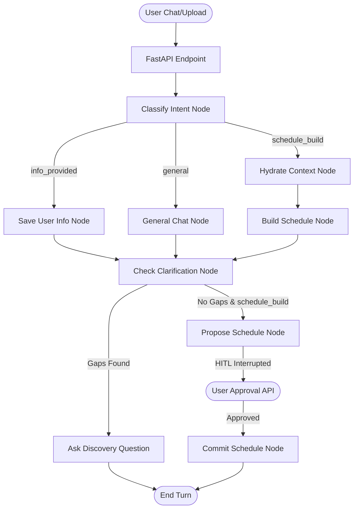

# LifeSync AI 📅🤖

<p align="center">
  
  
  
  
  
  
</p>

**LifeSync AI** is a state-of-the-art, agentic daily schedule optimizer and lifestyle assistant. Built on **LangGraph** (agentic state orchestration), **FastAPI** (streaming backend), and **React Native/Expo** (mobile client), it dynamically constructs balanced, optimal daily agendas for students and professionals alike.

The system automatically balances academic deadlines, professional tasks, and hobbies around your **non-negotiable daily habits** (like sleep, workout, and meditation).

---

## 📖 Table of Contents
- [🌟 Key Capabilities](#-key-capabilities)
- [📈 Agentic Workflows & State Graph](#-agentic-workflows--state-graph)
- [📂 Project Directory Structure](#-project-directory-structure)
- [🗄️ Firestore Database Schema](#%EF%B8%8F-firestore-database-schema)
- [🔌 REST API References](#-rest-api-references)
- [⚡ Model Tiers, Prompt Caching & Observability](#-model-tiers-prompt-caching--observability)
- [⚙️ Setup & Installation](#%EF%B8%8F-setup--installation)
- [📅 Core Scheduling Engine Rules](#-core-scheduling-engine-rules)

---

## 🌟 Key Capabilities

### 🧠 Intent Classification with Heuristic Fallback
- Classified via a primary Gemini model (or Groq backup) and automatically falls back to regex-based classification for test users.
- **Smart Query Routing**: Intelligently identifies retrieval queries (e.g., *"What is my Monday timetable?"*) and routes them to chat instead of overwriting schedules.

### 🖼️ Timetable Vision Extraction
- Users upload a photo of their college or work timetable (sent as `multipart/form-data` file URI to prevent low-end device OOM crashes).
- Gemini parses the image, generates structured JSON classes, and stores them securely.

### 📚 Syllabus & Calendar Crawling
- Input your college (e.g., *RVCE, CSE, 5th Sem, 2022 Scheme*).
- An asynchronous background scraper fetches the college academic calendar and parses syllabus PDFs directly from the VTU database to feed into your tasks list.

### 🛡️ Wellness & Habit Protection
- Non-negotiable routines (like Meditation at 6:00 AM) are locked and protected from task/class overlaps.

---

## 📈 Agentic Workflows & State Graph

LifeSync AI uses a state graph to manage chat sessions, parse user details, build calendars, and interrupt for user approval.



---

## 📂 Project Directory Structure

The repository is divided into a Python backend service and a TypeScript Expo mobile application:

```
├── .agents/                    # Specialist agent scripts, prompt instructions, and rules
├── backend/
│   ├── app/
│   │   ├── agents/             # LangGraph state nodes, router, and chat stream controllers
│   │   │   ├── discovery.py    # Onboarding gap identifier
│   │   │   ├── graph.py        # LangGraph StateGraph builder
│   │   │   ├── llm.py          # Schema-constrained LLM entry points (astructured / atext)
│   │   │   ├── nodes.py        # Graph computation nodes (Build, Commit, Hydrate)
│   │   │   ├── parser.py       # Entity & info parser (LLM + regex heuristic fallback)
│   │   │   ├── prompts.py      # Cache-friendly prompt assembly + static instructions
│   │   │   ├── schemas.py      # Pydantic models for every structured LLM output
│   │   │   └── state.py        # AgentState TypedDict definitions
│   │   ├── api/                # FastAPI routing paths (auth, chat streams, image uploads)
│   │   │   └── sse.py          # AI SDK v1 UI-message-stream frame writer
│   │   ├── data/               # Local JSON mappings & college catalogs
│   │   ├── memory/             # Postgres memory savers & checkpointer configurations
│   │   ├── tasks/              # APScheduler background jobs (Nightly Learning, Scrapers)
│   │   ├── tools/              # Specialized agent actions (Syllabus downloader, TMDB movie locator)
│   │   └── main.py             # FastAPI App root configuration
│   ├── scripts/                # Dev harness: capture an SSE sample / serve with fakes
│   ├── tests/                  # pytest suite (in-memory Firestore/LLM fakes, no credentials needed)
│   ├── requirements.txt        # Backend python dependencies
│   ├── requirements-dev.txt    # pytest + pytest-asyncio
│   ├── .env.example            # Copy to .env and fill in
│   └── firebase-service-account.json [EXCLUDED] # Credentials
├── mobile/
│   ├── app/                    # Expo Router structure (Tabs: Schedule, Profile, Academics)
│   ├── constants/              # Theme details and color tokens
│   ├── hooks/                  # Custom hooks (useAgentChat, useGeofence, useSchedule)
│   ├── services/               # Firebase listeners, API URL + auth headers
│   ├── verify-stream.mjs       # Replay a captured SSE sample through the real SDK transport
│   ├── verify-transport.mjs    # Assert the transport's request body matches the backend
│   ├── package.json            # Node.js dependencies
│   └── app.json                # Expo config manifest
├── README.md                   # Visual project guide
└── .gitignore                  # Ignored credentials list
```

---

## 🗄️ Firestore Database Schema

The system stores configuration files, user profile information, and schedule logs in Google Cloud Firestore:

| Collection Path | Document ID | Description | Key Fields |
| :--- | :--- | :--- | :--- |
| `users/{uid}` | `uid` | Core user preferences & onboarding state | `completed_discovery`, `college`, `branch`, `semester` |
| `timetables/{uid}` | `uid` | Extracted timetable classes by weekday | `Monday: [{"time": "09:00", "subject": "DSA"}]` |
| `academic_events/{uid}/items` | Auto-generated | Upcoming CIEs, exams, and assignment due dates | `title`, `type (cie/see)`, `due_date`, `completed` |
| `personal_schedule/{uid}` | `uid` | Fixed personal blocks (meditation, workouts) | `fixed_blocks: [{"title": "Meditation", "time": "06:00"}]` |
| `schedules/{uid}/days/{date}`| `YYYY-MM-DD` | User-approved daily schedule blocks | `approved: true`, `blocks: [{"time": "09:00", "title": "Math"}]` |
| `notifications/{uid}/pending`| `YYYY-MM-DD` | Scheduled notification reminders for the day | `reminders: [{"time": "08:50", "body": "Math in 10m"}]` |

---

## 🔌 REST API References

> [!NOTE]
> Every endpoint requires `Authorization: Bearer <firebase-id-token>`. The uid in
> the token is authoritative; a `user_id` in the request body that disagrees with
> it is rejected with `403`. When Firebase credentials are absent (local dev),
> the backend runs in a documented fallback that accepts the body `user_id` so
> the Expo mock-auth demo keeps working — see `backend/app/api/auth.py`.

### 1. Unified Agent Stream
- **Path**: `POST /api/chat`
- **Content-Type**: `application/json`
- **Request Body**:
  ```json
  {
    "user_id": "user_123",
    "thread_id": "thread_abc",
    "message": "schedule my day for 2026-06-15"
  }
  ```
- **Returns**: `text/event-stream` in the **AI SDK v1 UI-message-stream**
  protocol, declared with the `x-vercel-ai-ui-message-stream: v1` response
  header. The mobile client consumes it with the AI SDK's `useChat`, so the app
  contains no bespoke SSE parsing.
- **Thread namespacing**: the thread is stored as `{user_id}:{thread_id}`, so two
  users sending the same constant `thread_id` never share state.

Frames, in the order they arrive:

| Frame | Meaning |
| --- | --- |
| `{"type":"start","messageId":"..."}` | Opens the assistant message |
| `{"type":"text-start","id":"..."}` | Opens a text part |
| `{"type":"text-delta","id":"...","delta":"..."}` | Appends to that part |
| `{"type":"text-end","id":"..."}` | Closes it |
| `{"type":"data-schedule","data":{...}}` | A schedule payload (see below) |
| `{"type":"error","errorText":"..."}` | Terminal error for the turn |
| `data: [DONE]` | End of stream |

The `data-schedule` part carries `{"status": "proposed" | "approved",
"schedule": [block, ...]}`. A block is `{"time": "HH:MM", "title": "...",
"type": "study", "duration_min": 90, "notes": "..."}`. The client declares the
shape with `dataPartSchemas`, so it receives a parsed object rather than a JSON
string.

Only schedules *this run* produced are emitted: the endpoint tracks whether
`build_schedule` / `commit_schedule` fired, so a stale proposal from an earlier
turn on the same thread is never replayed. See `backend/app/api/sse.py`.

### 2. Timetable Image Extraction
- **Path**: `POST /api/upload/timetable`
- **Content-Type**: `multipart/form-data`
- **Payload**: `file` (URI binary), `user_id` (string).
- **Response**:
  ```json
  {
    "status": "success",
    "timetable": {
      "Monday": [{"time": "09:00", "subject": "DSA"}]
    }
  }
  ```

### 3. Approve Proposed Schedule
- **Path**: `POST /api/schedule/approve`
- **Content-Type**: `application/json`
- **Request Body**:
  ```json
  {
    "thread_id": "thread_abc",
    "feedback": { "approved": true, "edits": [] }
  }
  ```
- **Response**: Status `success` alongside details of saved Firestore schedules.

---

## ⚡ Model Tiers, Prompt Caching & Observability

Three speed levers, all in `backend/app/agents/llm.py` and
`backend/app/agents/prompts.py`.

### Two model tiers

Intent classification runs on **every** message, so it is the one call the user
feels on each keystroke. It does not need the reasoning model.

| Tier | Model | Used by |
| --- | --- | --- |
| `PLANNER` | `gemini-3.8-flash` | schedule building, chat, note summaries, calendar extraction |
| `ROUTER` | `gemini-3.5-flash-lite` | intent classification, college matching, syllabus-link extraction |

Both tiers share the same retry / fallback logic; only the model id and the
structured-output cache differ. A call site opts in with `tier=ROUTER`.

### Cache-friendly prompt layout

Gemini caches a request's **prefix**, so anything volatile placed early
invalidates the whole cached region. Every prompt is therefore assembled
static-first via `build_prompt(...)`:

```
role / rules / output shape    <- identical on every request, cacheable
user profile & patterns        <- stable for a given user
classes, tasks, notes, events  <- changes as data changes
date, feedback, latest message <- volatile, always last
```

The schedule prompt previously **opened with the date**, which defeated caching
entirely. `section(title, body, rule)` keeps the old formatting.

> [!IMPORTANT]
> **Caching does not fire yet.** `gemini-3.8-flash` only caches a request of at
> least 4096 input tokens; the assembled schedule prompt measures roughly 1.1k
> tokens even with a full syllabus loaded. The layout is correct and is a
> prerequisite, but the prompt needs to grow about 4x before any cache hit is
> recorded. `tests/test_prompts.py` pins that measurement rather than assuming
> the win. The prompt was deliberately **not** padded to clear the floor.

### Observability

- Set `LANGCHAIN_API_KEY` to export traces to LangSmith under
  `LANGCHAIN_PROJECT` (default `personal-ai-agent`). `setup_tracing()` is called
  from the app lifespan, before the first chain is built.
- With no key, nothing is exported and every call logs latency plus
  `input_tokens` / cached-% / `output_tokens` locally instead.

### Mobile: streaming, lists and the transport

The chat screen now uses the AI SDK rather than a hand-rolled SSE parser:

- `expo/fetch` replaces React Native's `fetch`, which cannot stream — without
  it the SDK buffers the whole response and the user sees nothing until the run
  ends.
- `DefaultChatTransport` supplies the absolute `API_URL` (the app is not served
  from the backend origin), the `Authorization` header resolved per request, and
  a `prepareSendMessagesRequest` adapter, because the SDK posts a `messages`
  array while the backend reads a single `message` string.
- `dataPartSchemas` types the schedule part, so the proposal UI receives an
  object instead of sniffing JSON out of the text.
- Chat and schedule lists moved from `FlatList` to **FlashList v2**
  (`@shopify/flash-list`), which is JS-only with no native module, so it needs no
  rebuild and drops all the `estimated*` props v1 required.

## ⚙️ Setup & Installation

> [!IMPORTANT]
> Make sure PostgreSQL is running locally and you have created a database instance before launching the backend memory store.

### 1. Neon Postgres setup
The LangGraph checkpointer and store live in Postgres. Neon gives you two
connection strings for the same database and **they are not interchangeable**:

| Variable | What it is | Use it for |
| --- | --- | --- |
| `DATABASE_URL` | **Pooled** — hostname carries a `-pooler` suffix, routed through PgBouncer in transaction mode | The application's normal query traffic |
| `DATABASE_URL_UNPOOLED` | **Direct** — no `-pooler` suffix | Schema migrations, `setup()` DDL, `pg_dump`, logical replication, `LISTEN`/`NOTIFY`, anything relying on `SET` |

Running DDL over the pooled endpoint fails on Neon in ways that never name
pooling: `prepared statement "s0" already exists`, a `SET search_path` that does
not survive its own transaction, or a write landing in a read-only transaction
the pooler inherited from an earlier client. `app/db.py` owns the routing so no
caller has to remember.

```bash
# Install the CLI and provision the service (creates neon.ts, .neon, skills)
npm i -g neon@latest
neon init -y --org-id <org> --project-id <project> --branch production --services postgres
neon deploy

# Pull both connection strings into .env
neon env pull
```

Then prove the wiring end to end — this drives the same code the running app
uses, so a pass means the app's startup path works, not just that a socket
opened:

```bash
npm run verify:db
```

It checks that both DSNs are present and target the same database, that the
database answers, that migrations are idempotent, and that both memory stores
round-trip a write and a read.

### 2. Backend Setup
```bash
# Navigate & initialize virtualenv
cd backend
python -m venv .venv
source .venv/bin/activate

# Install dependencies
pip install -r requirements.txt

# Create .env file and edit configuration keys
cp ../.env.example .env   # or run `neon env pull` at the repo root
```

Run the test suite (no Postgres, Firebase, or API keys required):
```bash
pip install -r requirements-dev.txt
pytest
```

From the repo root, `npm run build` byte-compiles the backend, lints it with
ruff, and type-checks the mobile app. `npm test` runs the backend suite. Both
pick up `backend/.venv` automatically if it exists, so a system Python without
the dependencies still works.
Start the local server:
```bash
uvicorn app.main:app --host 0.0.0.0 --port 8000 --reload
```

### 3. Mobile Setup
```bash
# Navigate & install node modules
cd ../mobile
npm install

# Run Dev Server
npx expo start
```

---

## 📅 Core Scheduling Engine Rules

LifeSync AI uses a deterministic rule-based generator when building user schedules to maintain calendar compliance:

| Trigger Scenario | Schedule Outcome | Styling/Notes |
| :--- | :--- | :--- |
| **Habits (e.g. Meditation)** | Lock strictly to requested times (e.g., 6:00 AM) | Type: `health` (Non-negotiable) |
| **CIE Exam $\le$ 7 days** | Insert **2-hour** study block daily | Type: `study` (Notes: *CIE Prep*) |
| **CIE Exam $\le$ 3 days** | Insert **3-hour** study block daily | Type: `study` (Notes: *CIE Prep CRITICAL*) |
| **Lab Record due tomorrow** | Insert **1.5-hour** writing block this evening | Type: `work` (Notes: *Urgent*) |
| **VTU Holiday (e.g. Yoga Day)**| Clear all university classes & study expectations | Rest day block inserted |
| **Saturday Night** | Query TMDB API, recommend film at **21:30** | Type: `entertainment` |
